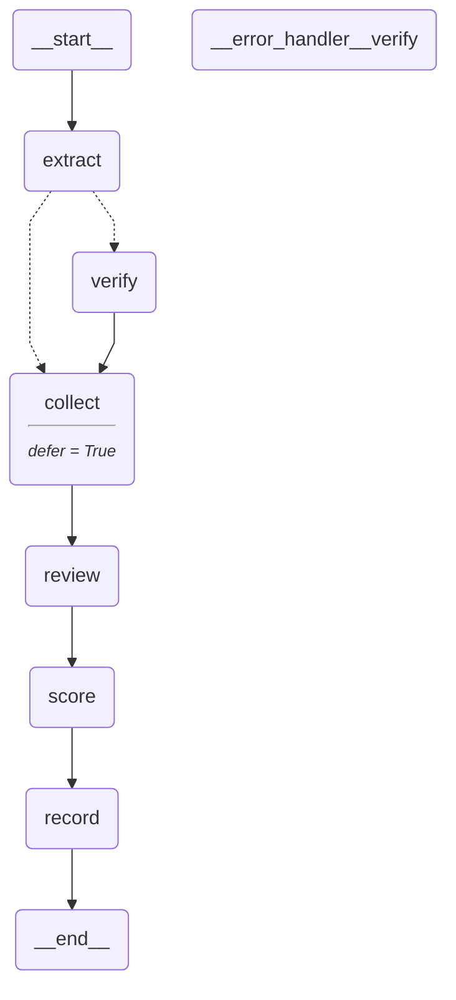

# Architecture

`cross-exam` is one LangGraph `StateGraph` (LangGraph 1.2.x), compiled with an in-memory
checkpointer so the review step can pause on `interrupt()`.

<!-- graph:start -->

<!-- graph:end -->

## Who decides what

| step | decided by | where |
| --- | --- | --- |
| acceptance criteria (C1..Cn) | code: markdown checklist parser | `inputs.parse_criteria` |
| the agent's final message | code: last assistant text in the JSONL, or the file | `inputs.read_claims` |
| claims, claim → criteria, one check per claim | **model** (structured output) | `graph.extract`, `prompts.py` |
| is the claim's quote really in the message? | code | `inputs.quoted_in` |
| run the check | code, in a sandbox copy | `verifiers.Sandbox` |
| claim verdict | code | each verifier in `verifiers.py` |
| overrule an UNVERIFIABLE verdict | a human, through `interrupt()` | `graph.review` |
| criterion verdicts, scores | code | `scoring.py` |
| scoreboard | code: SQLite | `store.Board` |

## State

`ExamState` holds plain dicts (pydantic models are dumped at node boundaries), so checkpoints stay
JSON-friendly:

- `criteria`, `summary`, `diff`, `task`, `agent`: the inputs.
- `claims`: the validated claims from `extract` (ids `K1..Kn`).
- `results`: one entry per verify branch, merged with an `operator.add` reducer.
- `final`: results in claim order, after any human overrule.
- `report`: the scored `Report`.

## Fan-out, timeouts, fan-in

`extract` returns a list of `Send("verify", {"claim": ...})`, one per claim. `verify` is an `async`
node registered with `timeout=` and `error_handler=`. When a check hangs past the node timeout
(`NodeTimeoutError`) or raises, LangGraph calls `verify_failed` with the same `Send` payload, which
writes an `UNVERIFIABLE` result with `source="error"` for that claim only. Inside the node, every
subprocess also has its own `asyncio.wait_for` timeout and is killed when it expires, so the node
timeout is a backstop (`--timeout` + 30 s).

`collect` is registered with `defer=True`, so it runs once, after every branch has written its
result.

## Review interrupt

With `--interactive`, `review` calls `interrupt(payload, response_schema=<JSON schema>)` listing the
UNVERIFIABLE claims. The schema is passed as a dict, so LangGraph shows it to clients but does not
enforce it; the node validates the resume value itself with `OverruleDecision` (verdict must be
`VERIFIED` or `CONTRADICTED`, reason at least 3 characters, only UNVERIFIABLE claim ids). An invalid
answer re-interrupts with an `error` message, so the CLI (or any client) can ask again. The runner
gives up after five bad answers and keeps every verdict as it was.

## Sandbox

`Sandbox` copies the repo into a temp directory, skipping `.git`, virtualenvs, `node_modules` and
caches. Checks run there, never in your working tree:

- environment reduced to `PATH`, `HOME`, locale, `TMPDIR`, `PYTHONPATH` (no API keys or tokens)
- `run_command` is `argv`, no shell; the program must be a bare name on the allowlist
- paths (`run_test` targets, `file_exists`) must resolve inside the copy
- `http_check` only accepts `localhost`, `127.0.0.1` and `::1`
- every subprocess is killed at the timeout

This is a guard against mistakes and a nosy examiner, not a security boundary: the repo's own
tests still run as you.

## Files

- `graph.py`: nodes, edges, `ExamDeps`
- `runner.py`: `examine()` runs the graph and answers interrupts through a callback
- `verifiers.py`, `scoring.py`, `inputs.py`, `store.py`, `prompts.py`
- `llm/`: `port.py` (the `LLM` protocol), `real.py` (LangChain chat models with
  `with_structured_output`), `fake.py` (scripted rules + heuristic fallback), `demo_script.py`
- `fixture.py`: the demo repo, criteria and summary; `graphs.py` draws the Mermaid diagram
